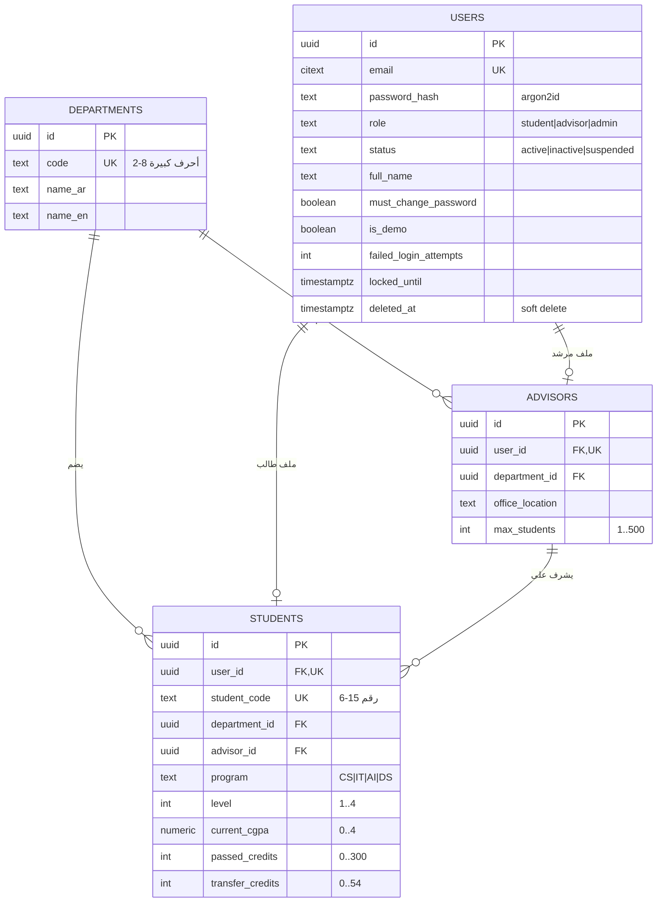
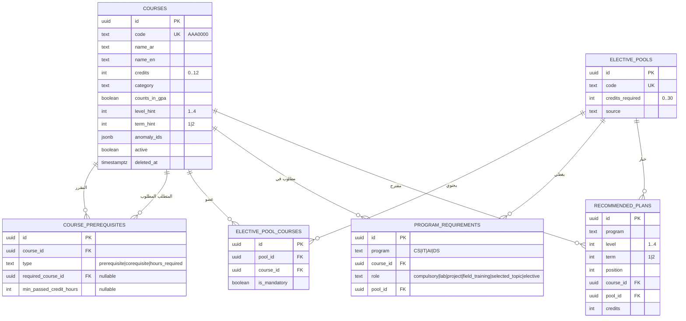
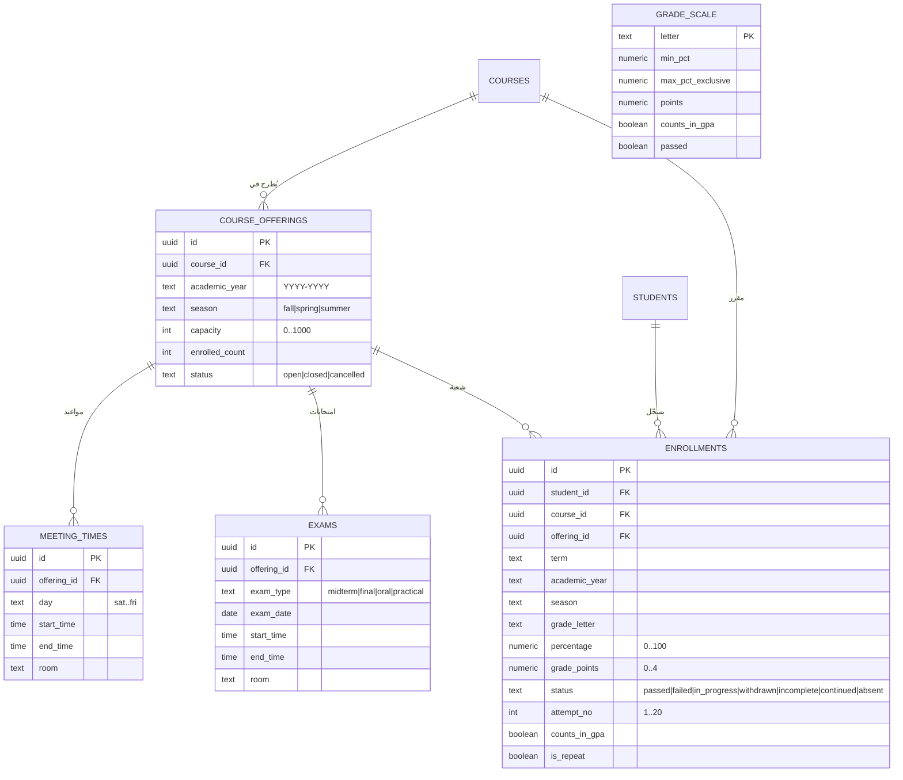
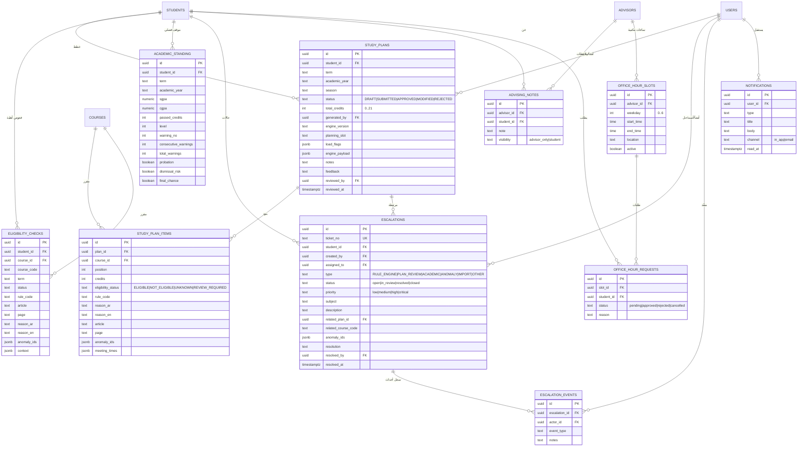
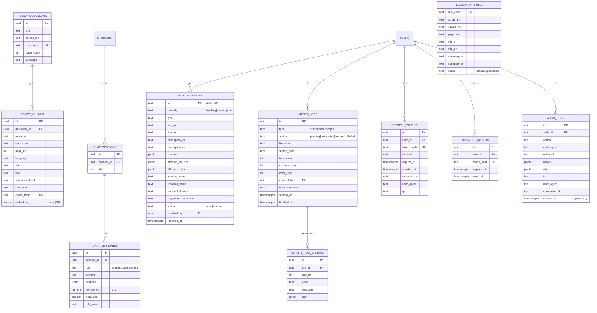

# ERD — Smart Academic Advisor

مخطط قاعدة البيانات الكامل (PostgreSQL 16 + pgvector). المصدر الوحيد للحقيقة هو
migration: [`db/migrations/1700000000000_init.js`](../db/migrations/1700000000000_init.js).
كل الجداول تستخدم `uuid` كمفتاح أساسي (ما عدا جداول مرجعية بكود نصي)، مع
`created_at`/`updated_at` وقيود `CHECK` و`FOREIGN KEY` وفهارس.

> كيف تشاهد المخطط: GitHub يعرض Mermaid تلقائيًا، أو افتح الملف في VS Code
> (إضافة Markdown Preview Mermaid)، أو الصق محتوى [`erd.mmd`](./erd.mmd) في
> <https://mermaid.live>.

---

## 1) الهوية والهيكل الأكاديمي



## 2) كتالوج المقررات ومتطلبات البرامج



## 3) العروض الفصلية والتسجيل والدرجات



`grade_scale` جدول مرجعي مستقل (A/B+/…/F) يستخدمه الاستيراد وحساب GPA ولا يرتبط بمفتاح خارجي.

## 4) الخطط والموقف الأكاديمي والمراجعة



## 5) الحوكمة واللائحة وRAG والأمان



> **علاقات منطقية غير مفروضة بـ FK:** `courses.anomaly_ids`،
> `data_anomalies.affected_rules`، `data_anomalies.affected_courses`،
> `study_plan_items.anomaly_ids`، و`escalations.anomaly_ids` كلها `jsonb`
> تحمل أكوادًا مرجعية للتدقيق. لا تُستخدم كـ Foreign Keys لأنها قد تشير إلى
> بيانات لائحة غير موجودة في جداول الأعمال (مثل قواعد pseudo أو مقررات محذوفة).

---

## فهرس الجداول (36 جدولًا)

### الهوية والصلاحيات
| الجدول | الغرض | المفتاح | علاقات أساسية |
|---|---|---|---|
| `departments` | الأقسام الأكاديمية | `id` | ← advisors, students |
| `users` | كل الحسابات (طالب/مرشد/أدمن) | `id` | 1:1 advisors/students، 1:N sessions/audit |
| `advisors` | الملف الإشرافي للمرشد | `id` | `user_id` UK، `department_id` |
| `students` | الملف الأكاديمي للطالب | `id` | `user_id` UK، `advisor_id`، `department_id` |

### الكتالوج والمتطلبات
| الجدول | الغرض | المفتاح | علاقات أساسية |
|---|---|---|---|
| `courses` | كتالوج المقررات | `id` | ← prerequisites, enrollments, plans |
| `elective_pools` | مجموعات الاختياري | `id` | ← pool_courses, requirements |
| `elective_pool_courses` | أعضاء كل مجموعة | `id` | `pool_id`+`course_id` UNIQUE |
| `course_prerequisites` | متطلب سابق/متزامن/ساعات | `id` | `course_id`، `required_course_id` |
| `program_requirements` | خطة كل برنامج | `id` | `program`+`course_id`+`role` UNIQUE |
| `recommended_plans` | الخطة الاسترشادية | `id` | `program`+`level`+`term`+`position` UNIQUE |

### العروض والتسجيل
| الجدول | الغرض | المفتاح | علاقات أساسية |
|---|---|---|---|
| `course_offerings` | عرض المقرر في فصل | `id` | `course_id`+سنة+فصل UNIQUE |
| `meeting_times` | مواعيد المحاضرات | `id` | `offering_id` |
| `exams` | امتحانات العرض | `id` | `offering_id` |
| `enrollments` | سجل الطالب الدراسي | `id` | `student_id`+`course_id`+`term`+`attempt` UNIQUE |
| `grade_scale` | تدرج التقديرات | `letter` | مرجعي |

### الخطط والإرشاد
| الجدول | الغرض | المفتاح | علاقات أساسية |
|---|---|---|---|
| `study_plans` | خطط دراسية (DRAFT افتراضيًا) | `id` | `student_id`، `generated_by`، `reviewed_by` |
| `study_plan_items` | مقررات الخطة مع القرار والمرجع | `id` | `plan_id`+`course_id` UNIQUE |
| `eligibility_checks` | أثر فحوص الأهلية | `id` | `student_id`، `course_id` |
| `academic_standing` | الموقف الفصلي والإنذارات | `id` | `student_id`+`term` UNIQUE |
| `escalations` | الحالات المحوّلة | `id` | `student_id`، `assigned_to`، `related_plan_id` |
| `escalation_events` | سجل أحداث الحالة | `id` | `escalation_id` |
| `advising_notes` | ملاحظات المرشد | `id` | `advisor_id`، `student_id` |
| `office_hour_slots` | الساعات المكتبية | `id` | `advisor_id` |
| `office_hour_requests` | طلبات الطلاب | `id` | `slot_id`، `student_id` |
| `notifications` | إشعارات داخلية/بريد | `id` | `user_id` |

### الحوكمة واللائحة والأمان
| الجدول | الغرض | المفتاح | علاقات أساسية |
|---|---|---|---|
| `regulation_rules` | قواعد اللائحة (rule_code) | `rule_code` | مرجعي للقرارات |
| `data_anomalies` | تعارضات البيانات | `id` | `resolved_by` → users |
| `policy_documents` | مستندات اللائحة | `id` | ← policy_chunks |
| `policy_chunks` | مقاطع + embedding 384 | `id` | `document_id`؛ HNSW cosine |
| `chat_sessions` | جلسات مساعد اللائحة | `id` | `student_id` |
| `chat_messages` | رسائل + citations/confidence | `id` | `session_id` |
| `import_jobs` | عمليات CSV | `id` | `created_by` |
| `import_row_errors` | أخطاء الصفوف | `id` | `job_id` |
| `refresh_tokens` | Refresh tokens مُشفّرة + عائلات | `id` | `user_id`، `family_id` |
| `password_resets` | رموز استعادة كلمة المرور | `id` | `user_id` |
| `audit_logs` | سجل تدقيق append-only | `id` | `actor_id` |

---

## قيود وفهارس ومحرّكات مهمة

- **Append-only audit:** تريجر `audit_logs_append_only` يمنع `UPDATE`/`DELETE`،
  وصلاحيات دور التطبيق `smart_advisor_app` لا تمنحهما أصلًا.
- **`updated_at`:** تريجر `set_updated_at()` على 16 جدولًا يعمل تلقائيًا.
- **pgvector:** `policy_chunks.embedding vector(384)` + فهرس
  `hnsw (embedding vector_cosine_ops)` لبحث RAG.
- **بحث نصي:** فهرس GIN على `courses` عبر `to_tsvector('simple', code || name_ar || name_en)`.
- **الفهارس الجزئية:** `users_role_idx` و`users_status_idx` و`courses_active_idx`
  كلها `WHERE deleted_at IS NULL` (soft delete).
- **قيود منطقية:** `course_prerequisites` تفرض وجود `required_course_id` أو
  `min_passed_credit_hours` حسب النوع، و`recommended_plans` تفرض وجود مقرر أو مجموعة.
- **قيود النطاق:** CGPA/GPA `0..4`، الساعات `0..300`، السعة `0..1000`،
  `attempt_no 1..20`، `confidence 0..1`.
- **Unique constraints** تمنع التكرار في: التسجيل، بنود الخطة، العروض الفصلية،
  أعضاء المجموعات، متطلبات البرامج، والخطة الاسترشادية.

## توليد المخطط من الصفر

```bash
cd backend-api
npm run migrate:up   # يستخدم MIGRATION_DATABASE_URL (owner role)
npm run seed         # idempotent: بيانات اللائحة + الحسابات التجريبية
```

لتصدير المخطط الفعلي من قاعدة بيانات قائمة:

```bash
pg_dump --schema-only --no-owner --no-privileges smart_advisor > schema.sql
```
